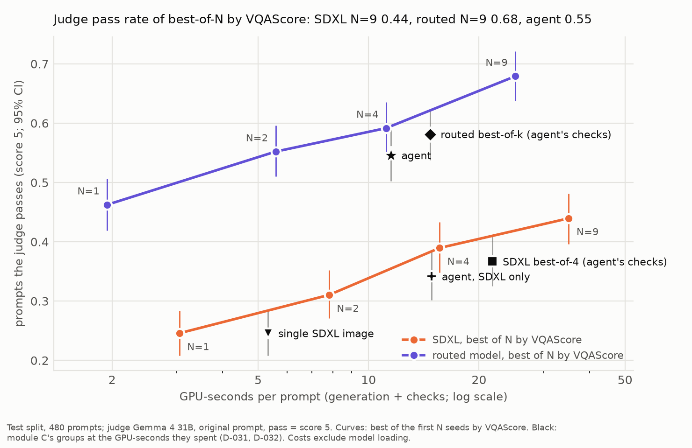

# GenProbe

**Which automatic metrics agree with human judgment, on which kinds of prompts — and can the
trustworthy ones drive automatic fixes?**

GenProbe generates images from several open text-to-image models, scores them with pluggable
metrics (VQAScore, CLIPScore, detector- and OCR-based checks, preference models, safety-filter
false positives, cost), meta-evaluates those metrics against human ratings by skill category,
and uses the reliable ones in a generation-debugging agent.



**In three sentences.** On GenAI-Bench, VQAScore orders 73 % of image pairs the way people do
(people among themselves: 81 %, CLIPScore 58 %), and on video it again beats CLIPScore, though
scoring the whole clip is no better than scoring its middle frame. Driving a generation-debugging
agent with those checks passes 55 % of test prompts, but sending each kind of prompt to the model
that is best at it and keeping the better of two samples by VQAScore does as well for half the GPU
time (figure). Training on VQAScore preferences and checking each shot of a multi-shot video
changed little that a judge or a person could see; what helped was the choice of model and, for
video, starting each shot from a keyframe (exploratory).

> **Status:** M2 is done: 9,600 images (4 models × 600 prompts × 4 seeds) scored
> with 8 metrics, checkers validated on 100 blind-labelled dev images, metric sanity checks run;
> results in [`REPORT.md`](REPORT.md) and `results/prompts_v1_test/`. M3 is done too: the
> metrics and a VLM judge were checked against GenAI-Bench's human ratings (`results/meta_eval/`,
> `results/judge/`) and against one blind annotator on our own images (`results/human_eval/`).
> Module C, the generation-debugging agent, is done as well (`results/agent/`), and so is module D:
> re-ranking, video, preference tuning and multi-shot video (`results/rerank/`,
> `results/video_meta_eval/`, `results/video/`, `results/dpo/`, `results/story/`). Every number
> here comes from a table in `results/`.

**Headline (test split, 480 prompts):** SD3.5 Medium and FLUX.1 schnell tie on prompt following
(VQAScore 0.680 vs 0.670, paired difference not significant) while FLUX is 4.1× faster; negation
is among the hardest skills for every model (VQAScore 0.21–0.29); rendered text is right (OCR
check) on 48 % of images at 1–2 words but 24 % at 5–8 words; CLIPScore barely separates the models. See
[`REPORT.md`](REPORT.md) and `results/prompts_v1_test/figures.md`.

**Which metric to trust (GenAI-Bench, 9,600 images rated by people):** VQAScore orders 73 % of
image pairs the way people do (people among themselves: 81 %), PickScore 67 %, HPSv2.1 67 %,
CLIPScore 58 %. Both pre-registered hypotheses tested so far hold: VQAScore beats CLIPScore on
counting prompts and both preference models overall. The preference models fall furthest behind on
negation (55–57 %, chance is 50 %). A VLM judge (Qwen3-VL-8B) agrees on 71 %, 2 points below
VQAScore on the same pairs, and when comparing two images it picks the one shown first 58 % of the
time (pre-registered H3 holds). See `results/meta_eval/hypotheses.md` and
`results/judge/test_r1/summary.md`. On our own images, one blind annotator (the author) agreed
with VQAScore on 86 % of 129 pairs, PickScore 78 %, HPSv2.1 75 % and CLIPScore 64 %
(`results/human_eval/summary.md`).

**Can the trusted metrics drive automatic fixes? (test split, 480 prompts, graded by Gemma 4 31B,
pass = score 5):** an agent that checks SDXL's image, diagnoses the failure and repairs it within
the GPU time of SDXL best-of-4 passes 55 % of prompts, against 37 % for best-of-4 (+18 points,
95 % CI [14, 22]). But plain routing, i.e. best-of-k from the model that was best on dev for that
kind of prompt, passes 58 %, and the agent does not beat it (−3.5 points [−8, +1]). Without
switching model, the agent does no better than best-of-4. So the gain comes from knowing which
model to use, not from diagnosing and repairing; the agent's one advantage is cost (21 vs 25
GPU-seconds per success). See `results/agent/testrule+testsdxl/judged.md`, and
`results/examples/agent_gallery.html` for 12 test prompts attempt by attempt. A blind check by the
author on 138 of the graded images matched the judge's pass / fail call on 76 % (κ 0.53); the judge
is the stricter of the two, and the person also sees no gain from the agent over routing
(`results/judge_check/summary.md`).

**Module D (same judge and test prompts unless stated):**
- *Re-ranking.* Keeping the best of N images by VQAScore raises SDXL's pass rate from 25 % (N = 1)
  to 44 % (N = 9), still below one image from the routed model (46 %). Re-ranking the routed model
  passes 55 % at N = 2, level with the agent at half its GPU time (`results/rerank/summary.md`).
- *Video* (GenAI-Bench-Video: 800 prompts, four 2023 models, rated by people). VQAScore on the whole
  video orders 67.5 % of pairs the way people do, against CLIPScore's 61.3 % (H4 holds), but not
  better than VQAScore on the middle frame (69.3 %, H5 contradicted;
  `results/video_meta_eval/hypotheses.md`). On 160 of the prompts, Wan2.2 TI2V-5B scores well above
  the four older models by VQAScore (+0.16 to +0.27) and moves far more, though VBench's aesthetic
  score puts it below three of them; no person rated its videos. LTX-Video 0.9.5 (2B) runs 14 times
  faster but scores level with the 2023 models and barely moves (`results/video/summary.md`).
- *Preference tuning.* Diffusion-DPO on 821 VQAScore preference pairs from SD 1.5's own samples did
  not measurably raise the judge's pass rate (+1.3 points, 95 % CI [−1, +4]; H6 inconclusive) and
  barely changed the images. In a blind check the author preferred neither image in 53 of 60 pairs
  for prompt following and in 52 of 60 for looks (`results/dpo/summary.md`,
  `results/dpo/human_check_r2.md`).
- *Multi-shot video.* Gemma 4 31B splits a brief into 3–4 shots, and an agent draws each shot's
  keyframe (FLUX.1 schnell), animates it (Wan2.2) and redoes shots that fail a VQAScore check. On 24
  test briefs (78 shots), the per-shot pass rate does not separate the arms (pre-registered H7 and
  H8 inconclusive). Over whole briefs, starting from keyframes scored higher than plain text to video
  for telling the brief (+0.29 of 5, exploratory). The agent's checks and redos added 13 % GPU time
  and nothing measurable. A blind check by the author preferred the agent's video in 7 of the 11
  briefs where he picked one (`results/story/summary.md`, `results/story/human_check.md`).

## Quick start (no GPU needed)

```bash
pip install -e .
make test          # sharding, resume, metric interface, config validation
make smoke-fake    # 20 prompts x 4 model configs with fake images -> data/_fake/
```

`smoke-fake` runs the full generation path (sharding, resume, atomic writes, manifests)
with a CPU backend that draws noise images, so the plumbing can be checked on a login node.

## Real run on Slurm

Written for SJSU CoE HPC3, whose nodes are offline; installs and downloads happen on the
gateway coe-hpc1, which shares `/home` with it (see `docs/hpc_notes.md`).
Paths are set in `scripts/paths.sh`.

```bash
# on coe-hpc1 (has internet), from ~/genprobe
bash scripts/setup_envs.sh gen            # uv venv in ~/envs/gen, wheels chosen for HPC3
bash scripts/setup_envs.sh eval
bash scripts/download_models.sh login     # once, HF read token (SD3.5 / FLUX are gated)
bash scripts/download_models.sh all       # generators, ~60 GB into ~/hf_home
bash scripts/download_models.sh scorers   # CLIP ViT-L/14 + Qwen2.5-VL-7B, ~18 GB
bash scripts/setup_envs.sh aux            # EasyOCR for the OCR checker
bash scripts/download_models.sh checkers  # Grounding DINO tiny + EasyOCR weights
bash scripts/download_models.sh m2        # PickScore, HPSv2.1, two safety filters, ~7.5 GB
bash scripts/setup_envs.sh judge          # vLLM for the VLM judge (own env: vLLM pins torch)
bash scripts/download_models.sh judge     # Qwen3-VL-8B-Instruct, ~17.5 GB

# on HPC3 (g17), from ~/genprobe
bash scripts/hpc_check.sh                 # partitions, GPU nodes, storage -> docs/hpc_check.md
sbatch slurm/probe_gpu.sbatch             # envs import torch and see the H100?
sbatch slurm/judge_probe.sbatch           # vLLM + Qwen3-VL-8B load offline and answer test questions?
sbatch slurm/judge.sbatch dev dev_r3      # VLM judge on the 80 dev prompts (rubric iteration) -> results/judge/
sbatch --time=01:00:00 slurm/judge.sbatch test test_r1   # once, frozen rubric: H3 and agreement with people
bash scripts/make_human_eval.sh           # own human evaluation: offline labelling package (docs/human_eval_protocol.md)
sbatch --array=0-1 slurm/gen.sbatch configs/gen/sdxl.yaml data/prompts/smoke.jsonl 2 --seeds 0
bash scripts/submit_scoring.sh data/prompts/smoke.jsonl   # CLIPScore + VQAScore, then
                                          # results/smoke/summary.md (CPU job)
bash scripts/check_gen_env.sh && bash scripts/run_v1.sh   # M2: prompt set v1, 9,600 images
METRICS="ocr detect" bash scripts/submit_scoring.sh data/prompts/prompts_v1.jsonl   # checkers, CPU nodes
METRICS="pickscore hpsv2 nsfw_sd nsfw_vit" CPU_METRICS="" bash scripts/submit_scoring.sh data/prompts/prompts_v1.jsonl
bash scripts/submit_sanity.sh             # metric sanity checks on dev images -> results/sanity/
bash scripts/make_label_set.sh            # blind labelling sheets for checking the checkers
bash scripts/make_report_assets.sh        # figures + example panels for REPORT.md
bash scripts/prepare_genai_bench.sh       # M3: GenAI-Bench prompts + image manifest (after fetch_genai_bench.sh on coe-hpc1)
SAMPLES=data/manifests/ext_genai_bench.jsonl METRICS="clipscore vqascore pickscore hpsv2" CPU_METRICS="" SUMMARY=0 \
  bash scripts/submit_scoring.sh data/prompts/genai_bench_1600.jsonl
bash scripts/run_meta_eval.sh             # agreement with GenAI-Bench ratings, H1/H2 -> results/meta_eval/
# module C (on coe-hpc1 first: bash scripts/download_models.sh gemma4_31b, the final judge, ~63 GB)
sbatch slurm/judge.sbatch test test_gemma --judge gemma4_31b         # the final judge's checks on GenAI-Bench
sbatch slurm/agent.sbatch devrule2 dev rule                          # agent on the 120 dev prompts
sbatch slurm/agent.sbatch devsdxl2 dev rule_sdxl                     # ablation: never switches model
sbatch slurm/grade.sbatch devrule2 devsdxl2                          # Gemma grades every group -> results/agent/
sbatch --time=03:00:00 slurm/agent.sbatch testrule test rule         # test: once, frozen rules only
```

Resubmitting any job is safe: finished samples are skipped, half-written files are cleaned up.

### Reproduce the smoke run with one command

```bash
# on HPC3, once the envs and weights above exist
bash scripts/run_smoke.sh     # 4 generation jobs -> CLIPScore + VQAScore jobs -> summary (CPU)
# on the laptop, when squeue is empty
scripts/hpc_sync.sh pull && cat results/smoke/summary.md
```

The summary has per-model scores with bootstrap CIs over prompts, per-category tables, metric
sanity checks, agreement with the human labels in `data/labels/`, and generation cost.

## Working from a laptop

Code is edited and unit-tested locally; the cluster only runs jobs. With an SSH alias `sjsu3`
(see `scripts/hpc_sync.sh` for the expected `~/.ssh/config` entries):

```bash
scripts/hpc_sync.sh push    # committed code, configs, prompt sets -> cluster
ssh sjsu3 "cd ~/genprobe && sbatch --array=0-1 slurm/gen.sbatch configs/gen/sdxl.yaml data/prompts/smoke.jsonl 2 --seeds 0"
scripts/hpc_sync.sh pull    # results/, logs/, env locks, docs/hpc_check.md -> laptop
```

`CLAUDE.md` and `.claude/settings.json` hold the working rules for Claude Code; submitting or
cancelling cluster jobs always asks for confirmation.

## Layout

```text
configs/gen/        one YAML per model (validated by pydantic; hashed into every record)
data/prompts/       prompt sets (in git); everything else under data/ is not, except
data/labels/        human labels (sample_id, correct = y/n/?, note), in git
genprobe/
  generate.py       batch generation: sharding + resume + manifests
  score.py          run one metric over a sample set: sharding + resume
  summarize.py      per-model / per-category tables with bootstrap CIs, cost table
  figures.py        leaderboard, paired model comparisons, category heatmap, quality-cost
                    frontier, text-length figure (run by slurm/summarize.sbatch)
  sanity.py         metric sanity checks: mismatched prompts, one-word counterfactuals,
                    repeatability (guide §7.9), results/sanity/
  label_set.py      blind labelling sets (numbered sheets, no scores or model names)
  examples.py       example panels for the report, picked by rule (results/examples/)
  contact_sheet.py  thumbnails of every image per category + a label template, for manual review
  metrics/          one plugin per metric, subclassing base.py: clipscore.py, vqascore.py, and the
                    checkers ocr.py (EasyOCR, text prompts) and detect.py (Grounding DINO,
                    counting / spatial prompts), preference scores pickscore.py and hpsv2.py,
                    safety filters safety.py (false positives on benign images)
  meta_eval.py      agreement of metrics with GenAI-Bench's human ratings, H1/H2 (results/meta_eval/)
  judge.py          VLM judge with vLLM (Qwen3-VL-8B, Gemma 4 31B); judge_eval.py: its checks
  human_eval.py     own blind human evaluation: labelling package and analysis (results/human_eval/)
  agent/            generation-debugging agent: core.py (checks, diagnoses, rules, budget), run.py
                    (rounds, baselines, audit log), gen.py, compare.py (grading by the judge)
  backends.py       diffusers backend + CPU fake backend for testing
  utils/            shard, manifest, atomic IO, environment fingerprint, HF cache checks
slurm/              job scripts (common.sh: job settings, GPU check, env activation)
scripts/            paths, env build + model download (coe-hpc1), HPC checks, laptop sync
docs/               hpc_notes.md (curated), decisions.md; hpc_check.md (raw, not in git)
results/            small tables and figures that back REPORT.md
```

## Traceability

Every generation record stores the config hash, git commit, GPU, run ID, seed, scheduler,
timing and peak memory; every score record stores the metric version (library version,
weights revision, prompt template and batch size), so results from different scorer setups
are never averaged together.
A full environment fingerprint is written once per job to `data/runs/`.

## Models and licenses

| Model | License |
| --- | --- |
| Stable Diffusion 1.5 | CreativeML OpenRAIL-M |
| SDXL base 1.0 | CreativeML OpenRAIL++-M |
| Stable Diffusion 3.5 Medium | Stability AI Community License |
| FLUX.1 [schnell] | Apache-2.0 |
| Scoring: OpenAI CLIP ViT-L/14 (CLIPScore) | MIT |
| Scoring: Qwen2.5-VL-7B-Instruct (VQAScore) | Apache-2.0 |
| Scoring: Grounding DINO tiny (detector checker) | Apache-2.0 |
| Scoring: EasyOCR CRAFT + english_g2 (OCR checker) | Apache-2.0 |
| Scoring: PickScore v1 | none stated on its model page |
| Scoring: HPSv2.1 | Apache-2.0 |
| Scoring: SD safety checker (CompVis) | none stated on its model page |
| Scoring: Falconsai NSFW image detection (ViT) | Apache-2.0 |
| Judge: Qwen3-VL-8B-Instruct | Apache-2.0 |
| Judge: Gemma 4 31B-it | Apache-2.0 |
| Video: Wan2.2 TI2V-5B | Apache-2.0 |
| Video: LTX-Video 0.9.5 (2B) | Open RAIL-M (Lightricks' license for LTX Video 2B 0.9.5, 5 March 2025) |
| Video scoring: VBench (source at `fd18b3d`) | Apache-2.0; the models it downloads carry their own |
| Video data: GenAI-Bench-Video (`zhiqiulin/GenAI-Bench-800`) | MIT |
| Preference tuning: diffusers' `train_diffusion_dpo.py` (v0.41.0) | Apache-2.0 |

No model weights, LoRA weights or videos are committed to this repository. The only generated
images are the small thumbnails in `results/examples/` (D-025), including the agent's gallery.
