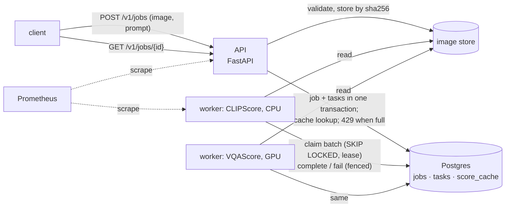

# GenProbe scoring service

GenProbe's prompt-following metrics behind an HTTP API: submit an image and a prompt, get back
the same scores the research pipeline computes (same plugins, same metric versions). Design
choices and their reasons are in `docs/decisions.md` (D-040); measured performance is in
`results/service/`.



## Run it

```bash
docker compose -f deploy/docker-compose.yml up -d --build --scale worker=2
curl -s -F image=@cat.png -F prompt="a cat sitting on a red sofa" http://localhost:8000/v1/jobs
# 202: {"job_id": "<id>", "status": "pending", "results": {"clipscore": {"status": "queued", ...}}, ...}
curl -s http://localhost:8000/v1/jobs/<id>
# 200: {"status": "done", "results": {"clipscore": {"status": "done", "value": <cosine>,
#        "metric_version": "open_clip==3.3.0/ViT-L-14:openai/cos", "cached": false, "attempts": 1,
#        "queue_seconds": ..., "total_seconds": ...}}, ...}
```

The worker image contains CPU torch, open_clip and the CLIP ViT-L/14 weights, so it starts
scoring without downloads. Add `--profile monitoring` for Prometheus on port 9090.

## API

| Endpoint | What it does |
| --- | --- |
| `POST /v1/jobs` | multipart `image` (PNG, JPEG or WebP; ≤ 10 MB, ≤ 4096 × 4096), `prompt` (1–1,000 characters), optional `metrics` (comma-separated). Optional `Idempotency-Key` header. **202** pending, **200** already done (all scores cached) or a repeated key, **400/413/415/422** invalid input, **409** key reused for another request, **429** queue full (`Retry-After: 5`). |
| `GET /v1/jobs/{id}` | the job and one result per metric: status, value, metric version, cached, attempts, error, `queue_seconds` (submit → first claim), `total_seconds` (submit → result). `Retry-After: 1` while pending. |
| `GET /v1/scorers` | live workers per metric and the versions they serve |
| `GET /healthz`, `GET /readyz` | process up; database reachable and schema current |
| `GET /metrics` | Prometheus: request latency by route, submissions by outcome, queue depth by metric |

With `GENPROBE_API_KEYS` set, the `/v1` endpoints need `Authorization: Bearer <key>`.

## Guarantees and failure modes

| Situation | What happens |
| --- | --- |
| Client retries a submission (timeout, network error) | With the same `Idempotency-Key`, it gets the first job back; nothing is scored twice. |
| Same image and prompt submitted again | Answered from `score_cache` at submit if a live worker serves that metric version; otherwise the worker finds it in the cache before scoring. |
| Worker killed mid-batch (`kill -9`, OOM, node lost) | Its leases run out (60 s); other workers claim the tasks again, up to 3 attempts in all. |
| Worker stalls past its lease, then wakes up | Its `complete`/`fail` is fenced on (worker, attempt) and changes nothing; the newer attempt's result stands. |
| One input breaks the scorer | The batch is split in halves down to single items; only that task fails, and is retried after 2 s, then 4 s, then marked failed with the error. |
| Workers fall behind | The queue grows to 1,000 tasks per metric, then submissions get 429 instead of waiting longer and longer. |
| Worker asked to stop (SIGTERM, `docker compose stop`) | It finishes the batch in hand, unregisters and exits. |
| Model upgraded | The metric version changes, so old cached scores are not reused. |
| Two migrations start at once | An advisory lock serialises them; each file applies once. |

## Configuration

API: `GENPROBE_DATABASE_URL`, `GENPROBE_SERVICE_DATA` (image store), `GENPROBE_SERVICE_METRICS`
(accepted metrics), `GENPROBE_API_KEYS`, `GENPROBE_MAX_QUEUE_DEPTH`, `GENPROBE_MAX_ATTEMPTS`,
`GENPROBE_MAX_IMAGE_BYTES`, `GENPROBE_MAX_IMAGE_PIXELS`, `GENPROBE_MAX_PROMPT_CHARS`,
`GENPROBE_AUTO_MIGRATE`. Worker: `GENPROBE_WORKER_METRIC`, `GENPROBE_WORKER_DEVICE`,
`GENPROBE_WORKER_BATCH_SIZE`, `GENPROBE_LEASE_SECONDS`, `GENPROBE_RETRY_BACKOFF_SECONDS`,
`GENPROBE_WORKER_METRICS_PORT`. Defaults are in `genprobe/service/config.py`.

**VQAScore on a GPU.** In an environment with `t2v_metrics` and CUDA torch (the `eval` env of
`scripts/setup_envs.sh`), with the service extras installed:
`GENPROBE_DATABASE_URL=… python -m genprobe.service.worker --metric vqascore --device cuda`, and add
`vqascore` to the API's `GENPROBE_SERVICE_METRICS`. The worker code is the same.

## Measured (one 2-vCPU VM running everything; `results/service/summary.md`)

- **CLIPScore (ViT-L/14) on CPU, one worker:** 1.36 images/s at batch 1. Batching does not help on
  this CPU (1.36–1.47 images/s up to batch 16) and only lengthens each batch, so CPU workers run
  batch 1.
- **Latency under load** (open loop, a fresh image per request): at 0.7 and 1.1 jobs/s (50 % and
  80 % of capacity) the median job is scored 1.2–1.4 s after submission, p99 under 4 s; at
  capacity (1.4/s) the median rises to 4.3 s; at 150 % the queue grows and the median reaches
  30 s. Submitting stays at 15–17 ms median throughout, because the API never scores.
- **Backpressure:** at 150 % with a 10-task queue limit, 47 of 132 requests got 429 and the
  accepted ones finished within 8.1 s (p99) instead of 53 s.
- **Cache:** with half the requests repeating an earlier one, 34 of 75 jobs were answered
  without scoring.
- **API and queue alone** (fake scorer with no model cost): 80 jobs/s with p99 end to end of
  0.04 s; at 100 jobs/s submissions slowed (p99 14 s) as the shared CPUs ran out.
- **Killed workers:** SIGKILLing one of three workers every 1.5 s (19 kills) while they scored 600
  jobs: all 600 finished, 104 needed a second or third attempt, none failed, and every score
  matched the expected value.
- **Idle pickup:** with LISTEN/NOTIFY a new job waited 0.004 s for a worker, against up to 1 s
  with polling alone.

## Tests and measurements

- `python -m unittest tests.test_service`: input validation, the image store, the fake scorer.
  With `GENPROBE_TEST_PG_DSN` pointing at a Postgres, also the queue (8 threads claiming 300
  tasks without overlap, lease takeover and fencing, backoff, dead-lettering, the cache), the
  worker (batching, isolating a bad item, a missing image, graceful stop) and the API
  (validation, idempotency, 429, auth, readiness, metrics), and a worker woken by NOTIFY. Each
  test runs in its own schema.
- `python -m genprobe.service.bench`: images per second one worker can score, by batch size.
- `python -m genprobe.service.loadtest`: open-loop load test (Poisson arrivals) reporting
  submit and end-to-end latency percentiles, throughput, 429s and failures.
- `python -m genprobe.service.chaos`: SIGKILLs workers while they score and checks that every task
  finishes once, with the right value.
- `python -m genprobe.service.report`: rebuilds `results/service/summary.md`.
