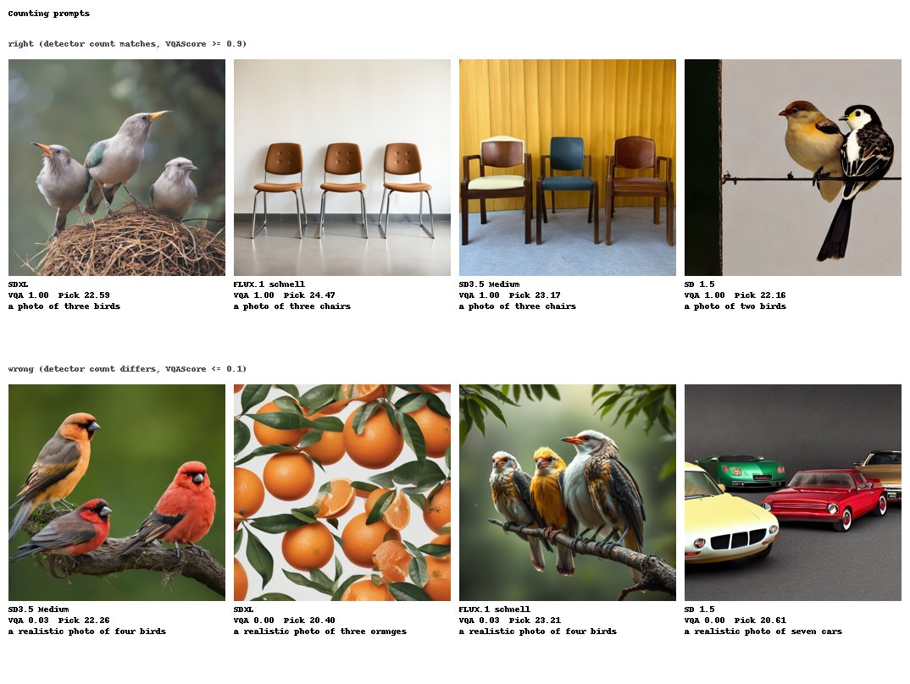
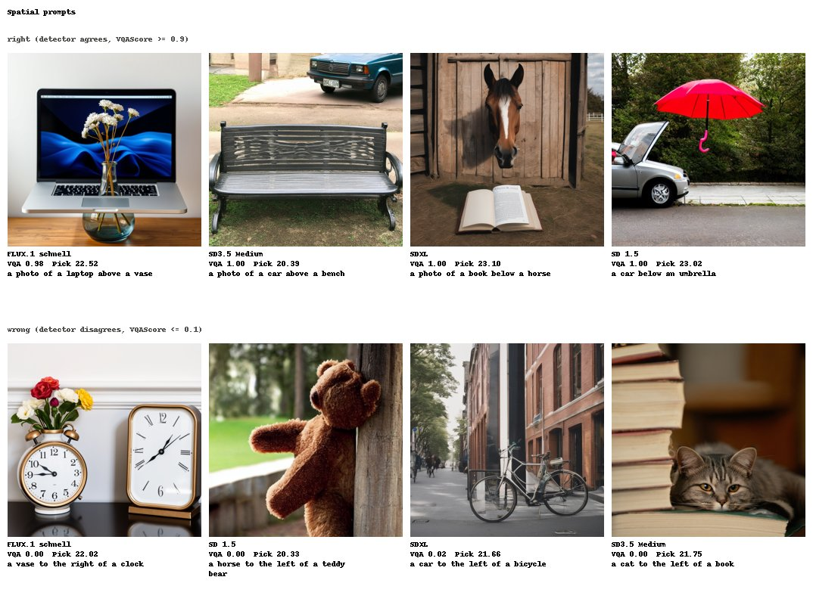
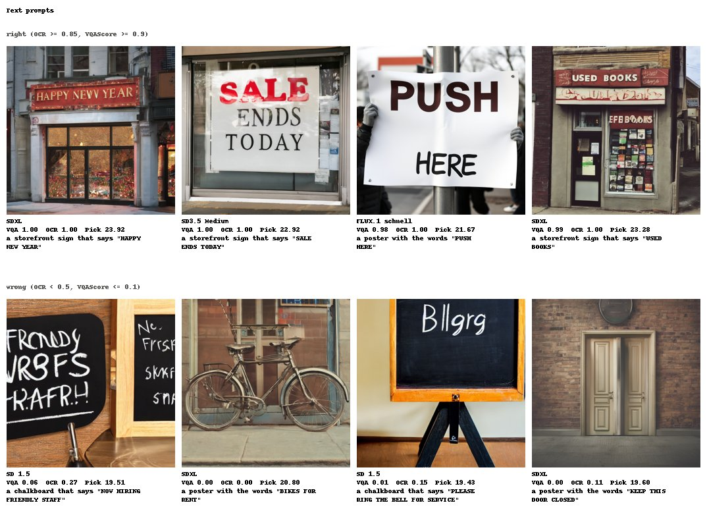
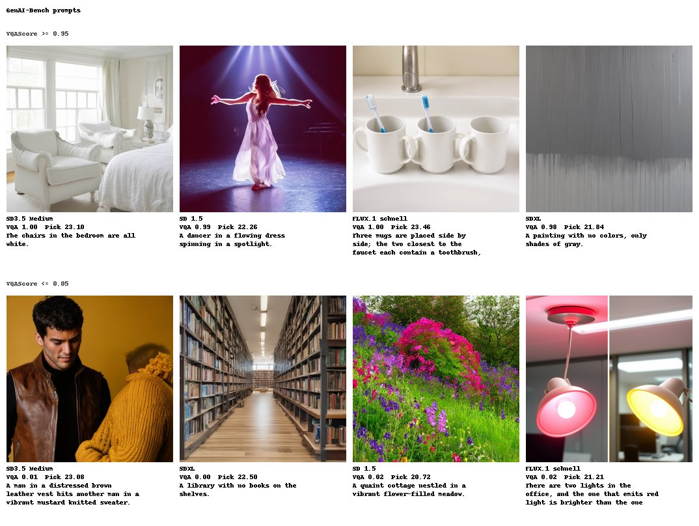
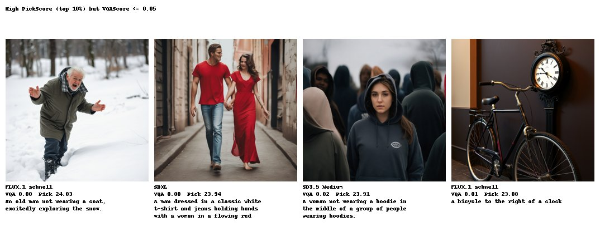

# Example images

Made 2026-10-19T21:30:41.086+00:00 at commit `03a6e4b` by `python -m genprobe.examples` from `results/prompts_v1_test/per_sample.csv` (test split). Chosen at random (seed 0) among images meeting each row's rule, spread over models; 256 px thumbnails (D-025).

## Counting prompts

- right (detector count matches, VQAScore >= 0.9): `sdxl__tc0066__s3`, `flux_schnell__tc0038__s1`, `sd35m__tc0038__s0`, `sd15__tc0065__s0`
- wrong (detector count differs, VQAScore <= 0.1): `sd35m__tc0067__s0`, `sdxl__tc0010__s3`, `flux_schnell__tc0067__s0`, `sd15__tc0056__s3`

## Spatial prompts

- right (detector agrees, VQAScore >= 0.9): `flux_schnell__ts0049__s2`, `sd35m__ts0051__s1`, `sdxl__ts0065__s2`, `sd15__ts0069__s1`
- wrong (detector disagrees, VQAScore <= 0.1): `flux_schnell__ts0035__s3`, `sd15__ts0010__s3`, `sdxl__ts0008__s0`, `sd35m__ts0016__s0`

## Text prompts

- right (OCR >= 0.85, VQAScore >= 0.9): `sdxl__tt0024__s3`, `sd35m__tt0028__s1`, `flux_schnell__tt0018__s3`, `sdxl__tt0020__s2`
- wrong (OCR < 0.5, VQAScore <= 0.1): `sd15__tt0034__s1`, `sdxl__tt0037__s1`, `sd15__tt0050__s3`, `sdxl__tt0030__s0`

## GenAI-Bench prompts

- VQAScore >= 0.95: `sd35m__gb0299__s1`, `sd15__gb0312__s2`, `flux_schnell__gb1573__s1`, `sdxl__gb0440__s1`
- VQAScore <= 0.05: `sd35m__gb0814__s0`, `sdxl__gb0448__s3`, `sd15__gb1164__s1`, `flux_schnell__gb1518__s3`

## High PickScore (top 10%) but VQAScore <= 0.05

- images: `flux_schnell__gb1359__s1`, `sdxl__gb0803__s2`, `sd35m__gb1366__s2`, `flux_schnell__ts0032__s2`

