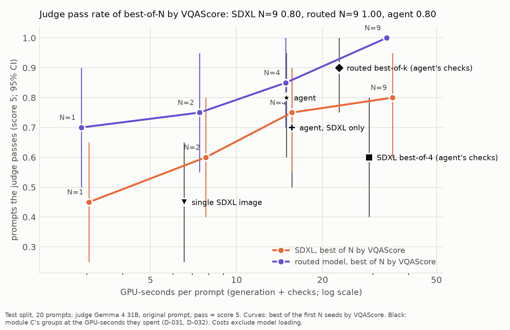

# Re-ranking curve (guide §11.1)

Made 2026-10-23T08:28:30.548+00:00 at commit `311f970` by `python -m genprobe.rerank analyze` (D-034). Judge `vllm==0.32.0/gemma-4-31b@842da37/bf16/vis560/img1024/tmpl-b9e98ed8` (grades `grade_rerank_smoke_gemma4_31b`), original prompts, pass = judge score == 5. 20 test prompts, 99 distinct picked images; 95 % CIs from resampling prompts.

`sdxl@N` / `routed@N`: of the first N seeds, the image with the highest VQAScore. Module C's groups (below the line) are the same prompts' images from `results/agent/testrule+testsdxl/`.

## Pass rate

| Group | all | counting | spatial | text | genai | GPU-s / prompt | GPU-s / success | mean VQAScore | VQAScore ≥ 0.9 |
| --- | --- | --- | --- | --- | --- | --- | --- | --- | --- |
| sdxl@1 | 0.450 [0.25, 0.65] | 0.400 [0.00, 0.80] | 0.200 [0.00, 0.60] | 0.600 [0.20, 1.00] | 0.600 [0.20, 1.00] | 3.1 | 6.8 | 0.659 | 0.450 |
| sdxl@2 | 0.600 [0.40, 0.80] | 0.600 [0.20, 1.00] | 0.400 [0.00, 0.80] | 0.800 [0.40, 1.00] | 0.600 [0.20, 1.00] | 7.8 | 13.0 | 0.771 | 0.650 |
| sdxl@4 | 0.750 [0.55, 0.90] | 0.800 [0.40, 1.00] | 0.400 [0.00, 0.80] | 1.000 [1.00, 1.00] | 0.800 [0.40, 1.00] | 15.6 | 20.8 | 0.817 | 0.650 |
| sdxl@9 | 0.800 [0.60, 0.95] | 0.800 [0.40, 1.00] | 0.600 [0.20, 1.00] | 1.000 [1.00, 1.00] | 0.800 [0.40, 1.00] | 35.1 | 43.9 | 0.898 | 0.850 |
| routed@1 | 0.700 [0.50, 0.90] | 0.400 [0.00, 0.80] | 0.600 [0.20, 1.00] | 0.800 [0.40, 1.00] | 1.000 [1.00, 1.00] | 2.9 | 4.1 | 0.815 | 0.750 |
| routed@2 | 0.750 [0.55, 0.95] | 0.600 [0.20, 1.00] | 0.600 [0.20, 1.00] | 0.800 [0.40, 1.00] | 1.000 [1.00, 1.00] | 7.4 | 9.9 | 0.897 | 0.850 |
| routed@4 | 0.850 [0.70, 1.00] | 0.800 [0.40, 1.00] | 0.800 [0.40, 1.00] | 0.800 [0.40, 1.00] | 1.000 [1.00, 1.00] | 14.9 | 17.5 | 0.992 | 0.950 |
| routed@9 | 1.000 [1.00, 1.00] | 1.000 [1.00, 1.00] | 1.000 [1.00, 1.00] | 1.000 [1.00, 1.00] | 1.000 [1.00, 1.00] | 33.5 | 33.5 | 0.999 | 1.000 |
| single | 0.450 [0.25, 0.65] | 0.400 [0.00, 0.80] | 0.200 [0.00, 0.60] | 0.600 [0.20, 1.00] | 0.600 [0.20, 1.00] | 6.5 | 14.6 | – | – |
| best_of_4 | 0.600 [0.40, 0.80] | 0.800 [0.40, 1.00] | 0.400 [0.00, 0.80] | 0.600 [0.20, 1.00] | 0.600 [0.20, 1.00] | 29.1 | 48.5 | – | – |
| routed_best_of_k | 0.900 [0.75, 1.00] | 0.800 [0.40, 1.00] | 0.800 [0.40, 1.00] | 1.000 [1.00, 1.00] | 1.000 [1.00, 1.00] | 22.8 | 25.4 | – | – |
| agent_rule | 0.800 [0.60, 0.95] | 0.800 [0.40, 1.00] | 0.800 [0.40, 1.00] | 0.800 [0.40, 1.00] | 0.800 [0.40, 1.00] | 14.9 | 18.7 | – | – |
| agent_rule_sdxl | 0.700 [0.50, 0.90] | 0.800 [0.40, 1.00] | 1.000 [1.00, 1.00] | 0.400 [0.00, 0.80] | 0.600 [0.20, 1.00] | 15.6 | 22.3 | – | – |

## Paired differences (same prompts)

| Comparison | all | counting | spatial | text | genai |
| --- | --- | --- | --- | --- | --- |
| sdxl@2 - sdxl@1 | 0.150 [-0.05, 0.35] | 0.200 [0.00, 0.60] | 0.200 [0.00, 0.60] | 0.200 [-0.40, 0.80] | 0.000 [0.00, 0.00] |
| sdxl@4 - sdxl@2 | 0.150 [0.00, 0.30] | 0.200 [0.00, 0.60] | 0.000 [0.00, 0.00] | 0.200 [0.00, 0.60] | 0.200 [0.00, 0.60] |
| sdxl@9 - sdxl@4 | 0.050 [0.00, 0.15] | 0.000 [0.00, 0.00] | 0.200 [0.00, 0.60] | 0.000 [0.00, 0.00] | 0.000 [0.00, 0.00] |
| sdxl@9 - sdxl@1 | 0.350 [0.15, 0.55] | 0.400 [0.00, 0.80] | 0.400 [0.00, 0.80] | 0.400 [0.00, 0.80] | 0.200 [0.00, 0.60] |
| routed@2 - routed@1 | 0.050 [0.00, 0.15] | 0.200 [0.00, 0.60] | 0.000 [0.00, 0.00] | 0.000 [0.00, 0.00] | 0.000 [0.00, 0.00] |
| routed@4 - routed@2 | 0.100 [0.00, 0.25] | 0.200 [0.00, 0.60] | 0.200 [0.00, 0.60] | 0.000 [0.00, 0.00] | 0.000 [0.00, 0.00] |
| routed@9 - routed@4 | 0.150 [0.00, 0.30] | 0.200 [0.00, 0.60] | 0.200 [0.00, 0.60] | 0.200 [0.00, 0.60] | 0.000 [0.00, 0.00] |
| routed@9 - routed@1 | 0.300 [0.10, 0.50] | 0.600 [0.20, 1.00] | 0.400 [0.00, 0.80] | 0.200 [0.00, 0.60] | 0.000 [0.00, 0.00] |
| routed@1 - sdxl@1 | 0.250 [0.05, 0.50] | 0.000 [0.00, 0.00] | 0.400 [0.00, 0.80] | 0.200 [-0.40, 0.80] | 0.400 [0.00, 0.80] |
| routed@2 - sdxl@2 | 0.150 [-0.05, 0.35] | 0.000 [0.00, 0.00] | 0.200 [-0.40, 0.80] | 0.000 [0.00, 0.00] | 0.400 [0.00, 0.80] |
| routed@4 - sdxl@4 | 0.100 [-0.15, 0.35] | 0.000 [-0.60, 0.60] | 0.400 [-0.40, 1.00] | -0.200 [-0.60, 0.00] | 0.200 [0.00, 0.60] |
| routed@9 - sdxl@9 | 0.200 [0.05, 0.40] | 0.200 [0.00, 0.60] | 0.400 [0.00, 0.80] | 0.000 [0.00, 0.00] | 0.200 [0.00, 0.60] |
| best_of_4 - sdxl@4 | -0.150 [-0.30, 0.00] | 0.000 [0.00, 0.00] | 0.000 [0.00, 0.00] | -0.400 [-0.80, 0.00] | -0.200 [-0.60, 0.00] |
| routed_best_of_k - routed@4 | 0.050 [0.00, 0.15] | 0.000 [0.00, 0.00] | 0.000 [0.00, 0.00] | 0.200 [0.00, 0.60] | 0.000 [0.00, 0.00] |
| agent_rule - sdxl@4 | 0.050 [-0.20, 0.30] | 0.000 [-0.60, 0.60] | 0.400 [-0.20, 1.00] | -0.200 [-0.60, 0.00] | 0.000 [0.00, 0.00] |
| agent_rule - sdxl@9 | 0.000 [-0.25, 0.25] | 0.000 [-0.60, 0.60] | 0.200 [-0.40, 0.80] | -0.200 [-0.60, 0.00] | 0.000 [0.00, 0.00] |
| agent_rule - routed@1 | 0.100 [-0.15, 0.35] | 0.400 [0.00, 0.80] | 0.200 [-0.60, 0.80] | 0.000 [-0.60, 0.60] | -0.200 [-0.60, 0.00] |
| agent_rule - routed@2 | 0.050 [-0.20, 0.30] | 0.200 [0.00, 0.60] | 0.200 [-0.60, 0.80] | 0.000 [-0.60, 0.60] | -0.200 [-0.60, 0.00] |
| agent_rule - routed@4 | -0.050 [-0.25, 0.15] | 0.000 [0.00, 0.00] | 0.000 [-0.60, 0.60] | 0.000 [-0.60, 0.60] | -0.200 [-0.60, 0.00] |
| agent_rule - routed@9 | -0.200 [-0.40, -0.05] | -0.200 [-0.60, 0.00] | -0.200 [-0.60, 0.00] | -0.200 [-0.60, 0.00] | -0.200 [-0.60, 0.00] |

Costs (median seconds per image, from module C's run): generation sdxl 3.05, sd35m 4.60, flux_schnell 1.13; VQAScore 0.85. Best of N costs N generations plus N VQAScore runs (none for N = 1). Model loading is not counted.

